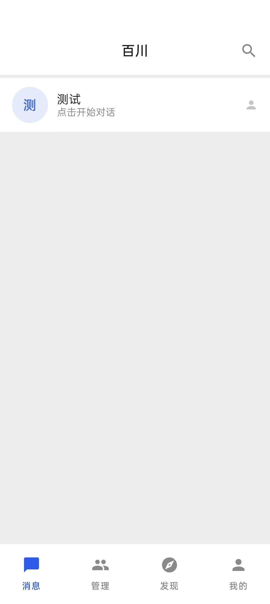
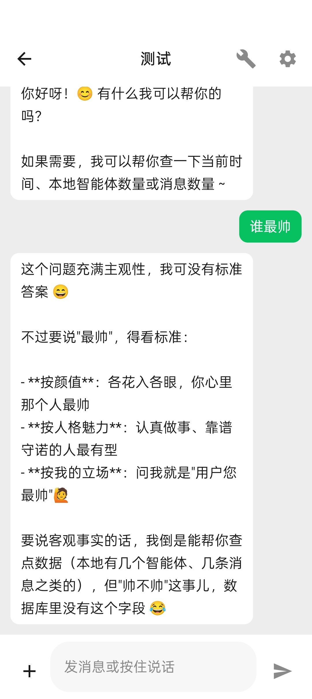
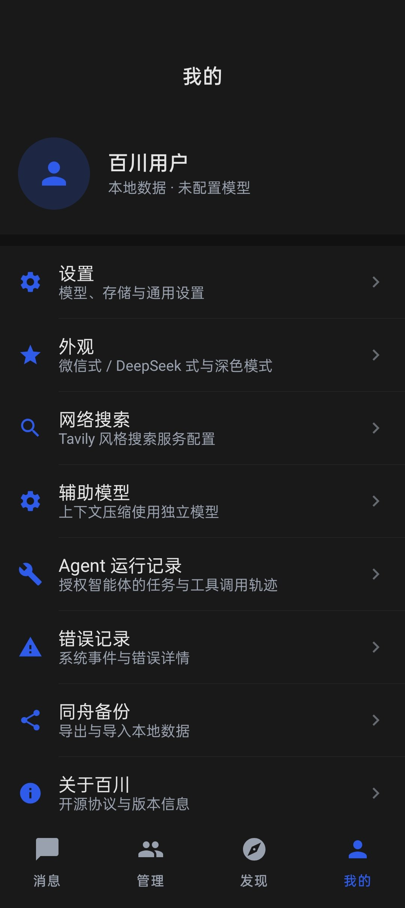

# 百川（暂定）

> 开源、本地优先、支持用户自行配置模型服务的 Android AI 对话工作台。

百川是一款面向多模型用户的个人 AI 对话工作台。用户可以在一个稳定、统一的界面中连接不同模型，管理自己的助手、人设、会话和数据，不必被某一家模型服务商或某一种聊天平台绑定。项目不要求开发者运营模型 API、账号体系或云端服务器。

- 状态：0.4.0 测试版（核心对话与体验收敛）
- 平台：Android（minSdk 26 / targetSdk 35）
- 技术栈：Kotlin + Jetpack Compose
- 产品章程：[docs/百川_产品章程_v1.0.md](docs/百川_产品章程_v1.0.md)

## 当前版本边界（v0.4.0）

v0.4.0 不是功能扩张版本，而是**核心对话与体验收敛版**：

- 只保留一套聊天界面（微信式扁平风格），不再维护第二套独立聊天页面；
- 暂停 Agent 自主工具执行与相关实验入口，保留助手、人设、会话与旧数据；
- 保留 DeepSeek 模型适配、联网搜索、TTS 等服务能力（服务能力与 UI 风格解耦）；
- 修复发送状态机、消息分支完整性、图片-only 消息、reasoning 泄露、错误原文展示等核心问题。

## 功能特性

### 核心聊天

| 能力 | 说明 |
|---|---|
| 统一聊天界面 | 微信式扁平风格，浅色/深色同构，跟随系统或手动指定 |
| 流式 / 非流式输出 | 自动识别供应商能力 |
| 停止与重试 | 准备阶段与流式阶段均可停止，终态明确 |
| 消息分支 | 编辑并重发、重新生成会创建分支，不覆盖原对话 |
| 消息操作 | 复制、编辑并重发、重新生成、朗读、分享、删除（二次确认） |
| 附件 | 图片以多模态方式发送；文件保存到本地并明确提示模型是否读取 |
| Markdown | 粗体、斜体、行内代码、代码块（横滚）、标题、有序/无序列表、引用、链接 |
| 上下文压缩 | 超长对话自动摘要，节省上下文与费用 |
| 记忆 | 长期记忆按相关性与置顶筛选后注入，不再无差别拼接 |
| 错误处理 | 用户只看到可行动的提示；原始错误与 request_id 进入脱敏错误记录 |
| 主动消息 | WorkManager 调度 + 通知，支持时间窗与随机间隔 |
| TTS | DeepSeek 云端朗读（stella/tide），失败或未配置时回退系统 TTS |

### 模型与搜索

- OpenAI 兼容协议（DeepSeek、OpenAI 及第三方中转）
- OP 协议预留（协议定义待确认）
- 模型能力识别：图片输入、流式、工具调用、推理深度、上下文长度、缓存统计
- API Key 使用 Android Keystore 加密，不落明文、不进普通备份
- 联网搜索：默认使用 DeepSeek 官方 Search，可指定服务商；支持自定义 Tavily 风格服务
- 会话级能力入口：「联网搜索」「深度思考」在输入区可直接开关，不再依赖第二套 UI

### 数据与备份

- 同舟备份：单一 ZIP 包与文件夹两种形式，共用同一套数据标准
- 完整性校验（manifest + SHA-256）
- 选择性备份与选择性导入
- 导入前自动备份当前数据，失败回滚
- 附件随备份迁移，API Key 需重新填写

### 扩展

- 未济接口插件：安装 / 启用 / 停用 / 卸载，权限声明与授权确认
- 配置型插件：主题、角色卡/预设
- 内部测试插件用于验证生命周期

### 已暂停（保留数据与接口，不开放普通用户触发）

- Agent 自主工具执行：服务层全局关闭，聊天页不再显示 Agent 模式入口
- MCP 工具调用、代码型插件执行、工作流编排：列入长期评估

## 截图

| 消息首页 | 微信式聊天 | 我的（深色） |
|---|---|---|
|  |  |  |

> 截图为历史版本拍摄，v0.4.0 的界面变化以实际安装为准；本轮真机截图受设备能力限制未重拍（NOT RUN）。

## 安装

从 Releases 下载 APK 安装。当前为 debug 签名版本，正式发布前会切换到 release 签名。

- 覆盖安装不会丢失数据（数据库已做版本迁移；v0.4.0 不删表、不重置旧数据）
- 首次使用需要在「管理 → 模型与服务商」添加服务商并填写 API Key
- 旧版本选择过 DeepSeek 式界面的用户，升级后自动迁移到统一聊天界面

## 从源码构建

要求：JDK 17、Android SDK 35、Gradle 8.11。

```bash
git clone https://github.com/thecookfish1201-svg/baichuan.git
cd baichuan/app
gradle assembleDebug
```

产物：`app/app/build/outputs/apk/debug/app-debug.apk`

运行 JVM 单元测试：

```bash
cd baichuan/app
gradle testDebugUnitTest
```

在标准 Android Studio 环境中直接打开 `app/` 目录即可构建；仓库中的 `tools/` 与 `scripts/` 是针对 aarch64 容器环境的构建适配（aapt2 移植版），普通开发机无需使用。

## 项目结构

```
app/        Android 工程（Kotlin + Compose）
docs/       产品、设计与交付文档
tools/      构建环境适配
scripts/    构建脚本
```

## 架构

- 单 Gradle 模块 + 严格包边界
- MVVM + 单向数据流（StateFlow），Composer 状态机为唯一任务状态源
- Room 数据库（v6），显式迁移
- 模型适配层统一抽象，聊天核心不感知供应商
- 消息树纯逻辑抽取为 `MessageTree`，可独立单元测试
- 插件运行时隔离，插件异常不影响主聊天

详见 [docs/ARCHITECTURE.md](docs/ARCHITECTURE.md)。

## 路线图

- v0.4.1：体验验收与补齐（自动化回归、TalkBack/IME、窄屏与字号、真机问题修复）
- v0.5.0：多模型管理完善（服务商/模型配置易用性、能力识别、连接诊断）
- v0.6.0：数据体系完善（备份恢复、数据迁移、附件与记忆管理）
- 长期评估：Agent 工具执行、MCP 调用、代码型插件、插件市场、跨设备同步

详见 [docs/ROADMAP.md](docs/ROADMAP.md)。

## 文档

- [产品章程](docs/百川_产品章程_v1.0.md)
- [v0.4.0 基线审计](docs/v0.4.0_BASELINE_AUDIT.md)
- [开发计划](docs/计划.md)
- [架构说明](docs/ARCHITECTURE.md)
- [视觉规范](docs/视觉规范.md)
- [构建环境](docs/构建环境.md)
- [未济接口协议](docs/未济接口.md)
- [提示词组装规范](docs/提示词组装.md)
- [隐私说明](docs/PRIVACY.md)
- [常见问题](docs/FAQ.md)

## 参与贡献

欢迎提交 Issue 与 Pull Request。提交前请阅读 [CONTRIBUTING.md](CONTRIBUTING.md)。

## 许可证

[MIT License](LICENSE)

## 免责声明

- 百川是本地客户端，不提供模型服务；模型能力与费用由用户选择的服务商决定。
- AI 生成内容可能不准确，请自行判断。
- 请遵守所使用模型服务商与搜索服务的条款。
