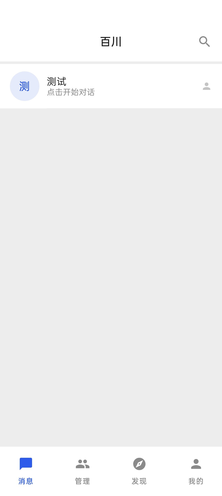
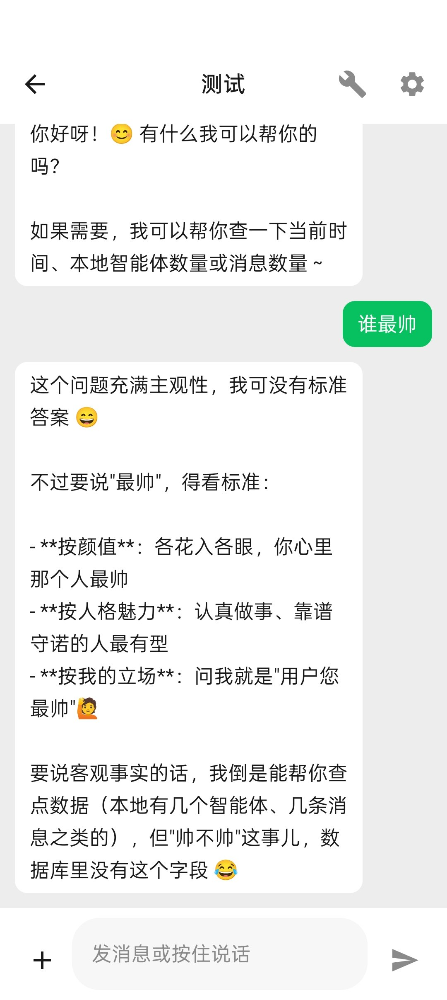
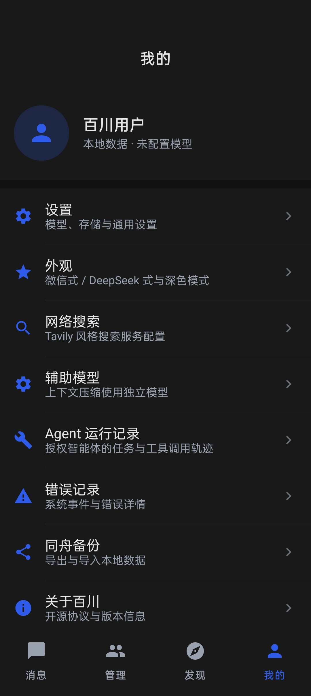

# 百川（暂定）

> 开源、可扩展、支持用户自行配置模型 API 的 Android AI 对话客户端。

百川是一个本地优先的 Android AI 对话应用。核心聊天不依赖任何插件，插件只负责扩展；模型 API、聊天数据、智能体配置全部由用户自己掌握。项目不要求开发者运营模型 API 或云端服务器。

- 状态：0.1.0 预览版（alpha），第一版功能已完成
- 平台：Android（minSdk 26 / targetSdk 35）
- 技术栈：Kotlin + Jetpack Compose
- 协议：未济接口（插件协议，设计中）

## 功能特性

### 核心聊天

| 能力 | 说明 |
|---|---|
| 微信式聊天界面 | 默认扁平风格，支持液态玻璃（规划中） |
| DeepSeek 官方风格 | 无头像与名称、思考链、操作栏、大圆角输入卡 |
| 流式 / 非流式输出 | 自动识别供应商能力 |
| 消息分支 | 编辑与重新生成会创建分支，不覆盖原对话 |
| 附件 | 图片（压缩后多模态发送）与文件 |
| 上下文压缩 | 超长对话自动摘要，节省上下文与费用 |
| 记忆 | 长期记忆注入，可增删置顶 |
| 错误系统 | 独立错误事件记录，聊天气泡只显示感叹号与居中提示 |
| 主动消息 | WorkManager 调度 + 通知，支持时间窗与随机间隔 |
| TTS | 系统朗读，云端 TTS 预留 |

### 模型与搜索

- OpenAI 兼容协议（DeepSeek、OpenAI 及第三方中转）
- OP 协议预留（协议定义待确认）
- 模型能力识别：图片输入、流式、工具调用、推理深度、上下文长度、缓存统计
- API Key 使用 Android Keystore 加密，不落明文、不进普通备份
- 网络搜索：默认使用 DeepSeek 官方 Search，可指定服务商；支持自定义 Tavily 风格服务

### 数据与备份

- 同舟备份：单一 ZIP 包与文件夹两种形式，共用同一套数据标准
- 完整性校验（manifest + SHA-256）
- 选择性备份与选择性导入
- 导入前自动备份当前数据，失败回滚
- 附件随备份迁移，API Key 需重新填写

### 扩展

- 未济接口插件：安装 / 启用 / 停用 / 卸载，权限声明与授权确认
- 配置型插件：主题、角色卡/预设
- 内部测试插件用于验证生命周期
- MCP 连接管理：服务器登记、连接状态、工具清单读取

### 实验性 Agent

- 按智能体授权，未授权不可用
- 免责说明模态弹窗 + 10 秒阅读门槛
- 真正的 Tool Calling 闭环：模型自主调用工具 → 百川校验权限并真实执行 → 结果回传模型 → 继续推理 → 最终回复
- 运行记录与工具调用审计

## 截图

| 消息首页 | 微信式聊天 | 我的（深色） |
|---|---|---|
|  |  |  |

## 安装

从 Releases 下载 APK 安装。当前为 debug 签名版本，正式发布前会切换到 release 签名。

- 覆盖安装不会丢失数据（数据库已做版本迁移）
- 首次使用需要在「管理 → 相关配置」添加模型服务商并填写 API Key

## 从源码构建

要求：JDK 17、Android SDK 35、Gradle 8.11。

```bash
git clone https://github.com/Thecookfish1201-svg/baichuan.git
cd baichuan/app
gradle assembleDebug
```

产物：`app/app/build/outputs/apk/debug/app-debug.apk`

在标准 Android Studio 环境中直接打开 `app/` 目录即可构建；仓库中的 `tools/` 与 `scripts/` 是针对 aarch64 容器环境的构建适配（aapt2 移植版），普通开发机无需使用。

## 项目结构

```
app/        Android 工程（Kotlin + Compose）
docs/       设计与交付文档
tools/      构建环境适配
scripts/    构建脚本
```

## 架构

- 单 Gradle 模块 + 严格包边界
- MVVM + 单向数据流（StateFlow）
- Room 数据库（v6），显式迁移
- 模型适配层统一抽象，聊天核心不感知供应商
- 插件运行时隔离，插件异常不影响主聊天

详见 [docs/ARCHITECTURE.md](docs/ARCHITECTURE.md)。

## 路线图

- 第二版：朋友圈、表情包、桌宠（第一版仅预留接入能力）
- 代码型插件执行环境与安全评估
- MCP 工具调用接入 Agent
- Agent 写操作工具（逐次确认）
- release 签名与正式分发

详见 [docs/ROADMAP.md](docs/ROADMAP.md)。

## 文档

- [开发计划](docs/计划.md)
- [架构说明](docs/ARCHITECTURE.md)
- [构建环境](docs/构建环境.md)
- [未济接口协议](docs/未济接口.md)
- [MCP 设计](docs/MCP设计.md)
- [Agent 安全设计](docs/Agent安全设计.md)
- [提示词组装规范](docs/提示词组装.md)
- [隐私说明](docs/PRIVACY.md)
- [常见问题](docs/FAQ.md)

## 参与贡献

欢迎提交 Issue 与 Pull Request。提交前请阅读 [CONTRIBUTING.md](CONTRIBUTING.md)。

## 许可证

[MIT License](LICENSE)

## 免责声明

- 百川是本地客户端，不提供模型服务；模型能力与费用由用户选择的服务商决定。
- AI 生成内容可能不准确，请自行判断。
- 实验性 Agent 功能存在风险，启用前请阅读应用内《注意事项与免责说明》，并避免在关键业务或不可逆场景中使用。
- 请遵守所使用模型服务商与搜索服务的条款。
